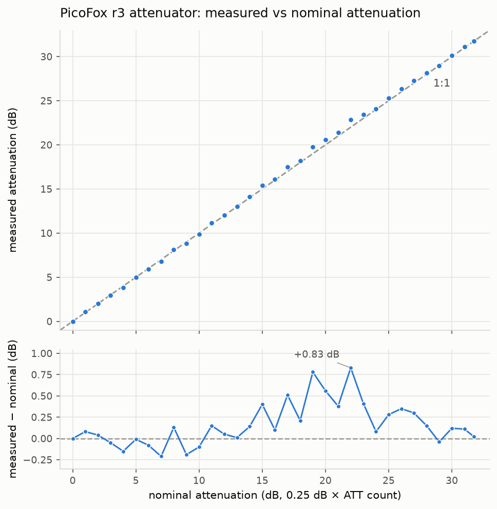
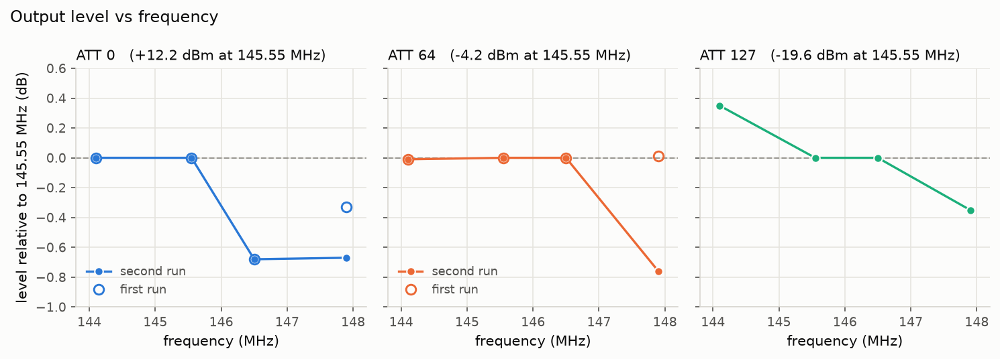
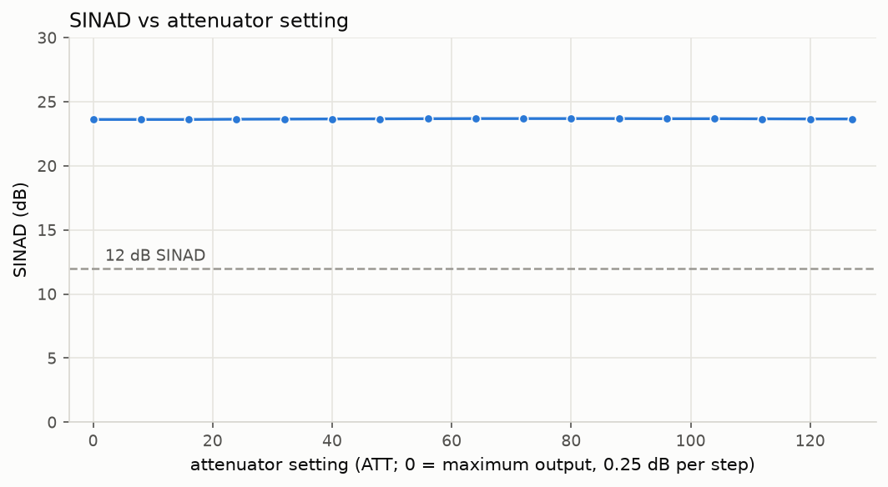

# Measured performance

These are bench measurements of **one PicoFox r3**, made on one day
(2026-10-23). Treat them as one example, not a specification.

**Setup.** The PicoFox's output went through a short coaxial cable into
the RF input of an HP 8935 test set. Nothing was radiated. The cable's
loss wasn't measured, so levels are as seen at the 8935 end. Levels come
from the 8935's spectrum analyzer; SINAD and deviation come from its FM
demodulator and audio analyzer.

**Firmware.** Measured with development builds of this firmware. The
changes since then affect only what happens when RF is off and when
Morse IDs are sent; the code that makes the signal gained just one flag
update per step, for the ID fix. This is from comparing the source code;
0.2.0 itself hasn't been re-measured.

## 1. Output level vs attenuator setting

Unmodulated carrier at 145.55 MHz. The attenuator was set every 4 counts
(1 dB), from `ATT 0` to `ATT 124`, plus `ATT 127`.

| | Result |
|---|---|
| Output at `ATT 0` | **+12.0 dBm** (11.99 dBm in this sweep; 12.14–12.17 dBm in later measurements) |
| Total range, `ATT 0` to `ATT 127` | **31.77 dB** (nominal 31.75 dB) |
| Every step lowers the level | yes, at all 33 settings |
| Largest difference from the ideal 0.25 dB per count | **+0.83 dB**, near 22 dB of attenuation |

What these numbers can and can't tell you:
- **The absolute level is approximate.** It relies on the 8935's
  calibration, which wasn't cross-checked: the 8935's power meter gave no
  reading at this level. The cable loss and the battery charge weren't
  recorded either, and the amplifier's output depends on battery voltage.
- **The lower panel combines two error sources:** the attenuator's own
  error, and the 8935's error in measuring level differences. This data
  can't tell them apart.

## 2. Output level across the band

Carrier at four frequencies and three attenuator settings, measured in two
runs. The second run added `ATT 127`. The plot shows each setting relative
to its own level at 145.55 MHz; the table gives absolute levels in dBm.

| | 144.10 MHz | 145.55 MHz | 146.50 MHz | 147.90 MHz |
|---|---|---|---|---|
| `ATT 0` | +12.17 | +12.17 | +11.49 | +11.84, then +11.50 |
| `ATT 64` | −4.20 | −4.19 | −4.19 | −4.18, then −4.95 |
| `ATT 127` | −19.23 | −19.58 | −19.58 | −19.93 |

(Where two values appear, the first and second runs differed. The other
values were the same in both runs to within 0.01 dB, except `ATT 127`,
which was measured in the second run only.)

- **144.1 to 146.5 MHz:** at `ATT 64` and `ATT 127` the level stays within
  0.35 dB. At `ATT 0` it's 0.68 dB lower at 146.5 MHz, and that repeated.
- **147.9 MHz wasn't repeatable:** between the runs, `ATT 64` changed by
  0.77 dB and `ATT 0` by 0.34 dB.
- **The cause of both is unknown.** The 8935 switches its input range
  automatically, and that hasn't been ruled out. Repeating with the 8935's
  input range fixed would show whether the PicoFox or the 8935 is
  responsible.

## 3. Best achievable SINAD

The 8935 demodulated the PicoFox directly, with no receiver in between,
to measure the quality of the PicoFox's own signal.

**Conditions:**
- `TONE 1000 3000` (the tone actually runs at 1010 Hz; see §4)
- 300 Hz high-pass and 3 kHz low-pass filters
- 17 attenuator settings from `ATT 0` to `ATT 127`, each the middle value
  of 8–16 readings

- **SINAD was 23.6–23.7 dB at every setting.**
- **Treat 23.6 dB as a lower bound, not the PicoFox's limit.** Through a
  real receiver (a UV-K5, measured with this project's sound-card SINAD
  analyzer, 200–3000 Hz), the same PicoFox signal read about **32 dB**.
  Why the 8935 reads lower isn't settled. The candidates:
  - the 8935's distortion notch may sit at exactly 1 kHz, while the
    PicoFox's tone runs at 1010 Hz (§4)
  - the stepped modulation's image at 4 kHz may partly pass the 8935's
    3 kHz filter
  - a receiver's de-emphasis and audio filtering reduce the PicoFox's
    distortion products before they're measured
- **Either way it's enough for 12 dB SINAD testing.** *Computed*, assuming
  the noise from the PicoFox and from the receiver add up: even at the
  23.6 dB lower bound, a receiver at a true 12.0 dB would read about
  11.7 dB.
- Repeated readings agreed within 0.01 dB. The attenuator was changed 16
  times while the tone was on, and SINAD was the same after each change.

## 4. The tone and its deviation

**Tone frequency.** The tone runs **1.0101 × the requested frequency**.
The 8935 read 303.0 Hz for 300, 505.0 for 500, 1518.4 for 1500, and
2020.2 for 2000. This comes from a timing constant this firmware carried
over from the stock PicoFox firmware ([THEORY.md §3](THEORY.md#3-making-fm)).

**Deviation.** The 8935's deviation meter reads peaks, and the stepped
modulation makes its readings depend on its audio filter
([THEORY.md §4](THEORY.md#4-what-the-steps-do-to-the-signal)). Two sweeps:

- *15 kHz low-pass, 300 Hz high-pass, 1 kHz tone:* the meter read
  1.2–1.4 × the commanded deviation (1405 Hz for 1000 commanded; 12096 Hz
  for 10000).
- *3 kHz low-pass, 300 Hz high-pass:* the commanded deviation was raised
  so that the delivered tone should be 3000 Hz (THEORY §4a). The meter
  read:

| Tone (Hz) | 300 | 500 | 800 | 1000 | 1500 | 2000 | 2400 |
|---|---|---|---|---|---|---|---|
| reading ÷ 3000 Hz | 0.75 | 0.94 | 1.04 | 1.08 | 1.22 | 1.51 | 1.86 |

The low readings are *consistent with* the meter's 300 Hz high-pass
filter. The high readings are *consistent with* the unwanted tone copy
near 5000 − f Hz getting through the 3 kHz filter. **Neither is
confirmed, and the true deviation is still unverified.** A carrier-null
(Bessel zero) measurement is planned as an independent check.

## 5. Morse ID

With a 5-character callsign, `OFF` (which sends the Morse ID first) took
**4.5 s** from command to reply.

## 6. Not measured yet

- Change in output as the PicoFox warms up
- How long RF is off during an `ATT` change
- Harmonics and spurious outputs
- The true deviation (Bessel null)
- Attenuator accuracy at frequencies other than 145.55 MHz
- Any other PicoFox
